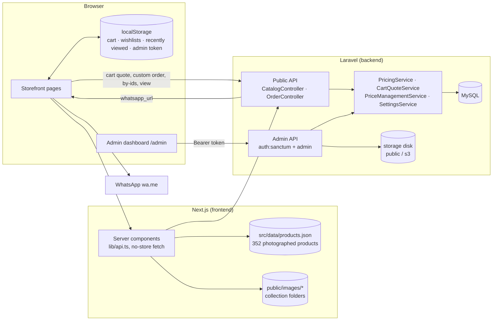
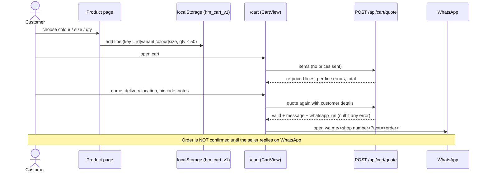
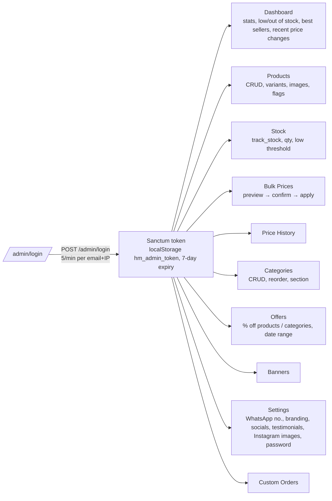
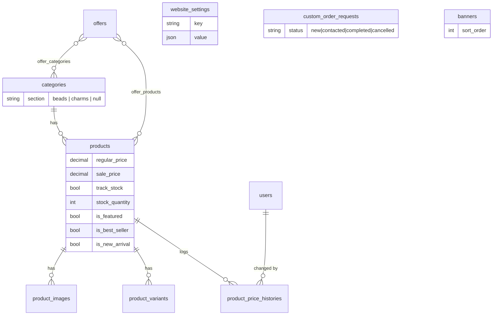

# OMR Collections — Flow & Functionality

A handmade jewellery storefront for India. Customers browse, then **order or enquire on WhatsApp**. There is
no payment gateway and no customer login. Prices are in ₹ INR.

| Part | Stack | Runs at |
|---|---|---|
| `backend/` | Laravel 13 REST API, Sanctum tokens, MySQL (SQLite for a quick try) | `http://localhost:8000/api` |
| `frontend/` | Next.js 16 App Router, React 19, TypeScript, Tailwind v4 | `http://localhost:3000` (shop) · `/admin` (dashboard) |
| `docs/` | `API.md` (endpoint reference), image rename manifests | — |

---

## 1. Architecture

### One product catalogue (key point)

All products – the 352 imported photographed products (`source = photo_catalogue`) and every
product added in the admin – live in the database and are managed in **Admin → Products**.

- Listings (`/shop`, `/collections/*`, `/new-arrivals`, home New Arrivals, wishlist, sitemap) are
  built from `GET /api/catalog` (`frontend/src/lib/live-catalog.ts`) on each request: only enabled
  products, with live prices and Sold Out / Discontinued badges.
- `/products/[slug]` reads `GET /api/products/{slug}`; a 404 (disabled/deleted) shows "Product not found".
- `frontend/src/data/products.json` is only a fallback when the API cannot be reached (browsing
  only; ordering always goes through `/api/cart/quote`) and the source for prerendered collection
  covers. Wishlists saved with catalogue ids (`product-001`) keep working because the id is the
  product code.
- Two independent product fields: **enabled** (`is_active`: shown on the website or not) and
  **availability** (`availability_status`: available / sold out / discontinued). Only enabled +
  available (+ in stock when stock is tracked) products can be ordered; the server enforces this.

---|---|---|
| Source | `frontend/src/data/products.json` + images in `frontend/public/images/<collection>/` | `products`, `categories`, etc. in MySQL |
| Size | 352 products in 11 collections (jasmine hair accessories 67, bangles 51, invisible chains 47, headbands 36, alligator clips 34, brooch pins 27, U pins 26, keychains 23, silk thread jhumka 19, haldi kumkum sets 12, rings 10). 90 are flagged new arrivals. | Seeded demo data (beads & charms sections plus general categories), then whatever the admin adds |
| Price / stock | None. "Price on request" | Full pricing, offers, variants, stock |
| Customer action | **Enquire on WhatsApp** (one product per message) | **Add to cart → WhatsApp order** (server-priced) |
| Managed by | Editing JSON and image folders, then rebuilding (`npm run catalog:check` lists photos with no entry) | Admin dashboard |
| Id format | `"product-001"` | numeric |
| Wishlist key | `hm_wishlist_catalog_v1` | `hm_wishlist_v1` |
| Used on | `/shop` (default), `/collections/*`, `/new-arrivals`, home New Arrivals, gallery fallback | `/categories/*`, `/shop?best_seller=1/featured=1/on_sale=1`, home beads/charms/featured/best sellers/offers |

`/products/[slug]` checks the photo catalogue first and falls back to the API, so **a photo-catalogue slug hides
an API product with the same slug**.

---

## 2. Storefront routes

| Route | Data | What it does |
|---|---|---|
| `/` | Mixed | Hero → Signature collections (from image folders) → *streamed from the API:* Beads circles, Charms circles, Shop by Category, Featured → Jhumka feature → Handmade accessories grid → Bangles feature → New Arrivals (photo catalogue, rotates through collections) → *API:* banner strip, Best Sellers, Special Offers → Custom-order promo → Why choose us, Testimonials, Instagram gallery (from settings, falls back to catalogue photos) → Recently viewed → Gifting CTA |
| `/shop` | Photo catalogue | Search, collection filter, sort (latest / name), 24 per page. `?new=1` alone redirects to `/new-arrivals`. `?best_seller`, `?featured`, `?on_sale` switch to the API listing |
| `/categories/[slug]` | API | Category listing with price, availability and sort filters |
| `/collections` | Image folders | All signature collections + handmade categories |
| `/collections/[slug]` | Image folders + catalogue | Header, gallery (catalogue products first, then uncatalogued photos), WhatsApp enquiry per photo (streamed in once settings load), related collections. Prerendered by `generateStaticParams` |
| `/collections/handmade-…` | Image folders | Grouping page for `handmade_jewellerycollections/*` |
| `/new-arrivals` | Photo catalogue | `isNewArrival` products, newest photo first, chips per collection |
| `/products/[slug]` | Catalogue → API | Catalogue: gallery, "Price on request", Enquire on WhatsApp, share, reviews, related. API: gallery, price, **PurchasePanel** (colour/size/qty → cart), stock, share/ask, description, JSON-LD, view tracking, related, recently viewed |
| `/cart` | API (client) | Cart lines from localStorage, re-priced live by `POST /cart/quote` |
| `/wishlist` | Both | Shows saved catalogue items and saved API products (`/products/by-ids`) |
| `/custom-order` | API (client) | Custom request form with optional reference photo |
| `/sitemap.xml`, `/robots.txt`, OG image | Both | Sitemap merges static routes, collections, catalogue products and API `/sitemap` (falls back to static entries if the API is down) |

The layout (`app/(shop)/layout.tsx`) streams the header and footer from `/settings`. Metadata (title, favicon,
description) also comes from settings.

---

## 3. Core flows

### 3.1 Order a priced product (API catalogue)

On the server, `CartQuoteService` checks each line: the product is active and its category is active, the colour
and size are valid, the variant exists, there is enough stock, and the quantity is 1–50. It prices each line
through `PricingService` and builds the WhatsApp message. **Prices from the client are never trusted.** The
customer's name and location are kept in localStorage for the next order.

### 3.2 Enquire about a photographed product (photo catalogue)

Customer opens a product or a collection photo → **Enquire on WhatsApp** → `wa.me` link with a pre-filled
message containing the product name, collection, code (`product-NNN`) and page URL. Nothing is stored on the
server.

### 3.3 Custom order

`/custom-order` form → client-side checks (Indian mobile number regex) → `POST /api/custom-orders` (multipart,
10/min per IP) → server validates, stores the reference image, saves a `custom_order_requests` row and returns
`whatsapp_url` → browser opens WhatsApp. The admin then works the request through `new → contacted → completed /
cancelled` in **Admin → Custom Orders**.

### 3.4 Wishlist & recently viewed

Both are stored in localStorage only (no login), with up to 100 wishlist items and 12 recently viewed items.
Stores use `useSyncExternalStore`, so they stay in sync across components and tabs. API product views also call
`POST /products/{id}/view`, which drives the "popular" sort.

### 3.5 Admin

`useAdminApi()` attaches the token. A **401** response clears the token and redirects to `/admin/login`.
Non-admin users get **403** from the `EnsureAdmin` middleware.

---

## 4. Business rules (backend)

**Pricing** (`PricingService`, the single source of truth)
- Selling price = the lower of the **sale price** and **regular price − best running offer %** (rounded to the rupee).
- An offer applies to selected products or whole categories, and only between its start and end dates.
- A variant's `additional_price` is added on top.
- Price filters and sorts use an equivalent SQL expression (`effectivePriceSql`), so listings match the quote.

**Price management** (`PriceManagementService`)
- Every change (manual, product form or bulk) is logged in `product_price_histories`.
- Bulk updates have a scope (all / category / products) and a target (regular / sale / both).
- Bulk operations: ±%, ±₹, set a fixed price, or clear the sale price. Optional rounding to ₹1, ₹5 or ₹10.
- Changes are previewed first and need `confirm: true`. They run in a transaction.
- A sale price that would end up ≥ the regular price is removed.

**Stock**
- With `track_stock` off, the product is made to order and always orderable.
- With variants, stock is tracked per variant, and product stock is the sum of active variants.
- A per-product low-stock threshold feeds the dashboard and the Stock page.

**Security**
- Rate limits: API 240/min, login 5/min, public forms 10/min.
- CORS is restricted to `CORS_ALLOWED_ORIGINS`.
- All quantities, pincodes (6 digits) and mobile numbers are validated on the server.

**Media**
- Uploads go through `App\Support\Media`, and each record stores its disk. Set `MEDIA_DISK=s3` (plus
  `NEXT_PUBLIC_IMAGE_HOSTS`) to move uploads to S3 or Cloudinary without code changes.

---

## 5. Data model

Tables with soft deletes: categories, products, offers, custom_order_requests. Deleting a category leaves its
products uncategorised.

---

## 6. Frontend code map

| Path | Role |
|---|---|
| `src/lib/api.ts` | Server-only API client (`cache: "no-store"`, React `cache` to avoid duplicate calls in one render) |
| `src/lib/client-api.ts` | Browser API client: `fetchQuote`, `fetchProductsByIds`, `recordView`, `ApiError` |
| `src/lib/admin-api.ts` | `useAdminApi`, form-data and error helpers |
| `src/lib/store.ts` | localStorage stores: cart, two wishlists, recently viewed, admin token |
| `src/lib/catalog.ts` | Photo catalogue queries: listing, new arrivals, related products, categories |
| `src/lib/collections.ts` / `.server.ts` | Collection metadata, and discovery of `public/images` folders with `fs` at build/render time |
| `src/lib/home-content.ts` | Hand-picked homepage images |
| `src/lib/reviews.ts` + `data/reviews.json` | Static reviews (currently empty) keyed by `product-NNN` or `api-<id>` |
| `components/shop/*` | Cards, grids, filters, PurchasePanel, CartView, WishlistView, CustomOrderForm, Gallery |
| `components/collections/*`, `components/home/*` | Collection and homepage sections |
| `components/admin/*` | AdminShell, ProductForm, ProductTable, UI primitives |
| `next.config.ts` | `cacheComponents`, image hosts for API storage and S3/Cloudinary, local-IP allowance in dev |

---

## 7. Observations & gaps

1. **Resolved – single catalogue.** The photo catalogue is imported (`php artisan catalog:import-photos`)
   and managed in the admin with prices, colours, sizes, availability, enable/disable and bulk actions.
2. **Resolved – slug collisions.** The API is the only source for product pages; the importer refuses
   slugs that already belong to another product.
3. **Two wishlists and two review key schemes**, because there are two kinds of id.
4. **No orders table.** Once WhatsApp opens there is no server record of the order; only custom orders are
   saved. The README already notes that the quote service output is ready to persist.
5. **Reviews are static and empty.** They are not admin-managed, and testimonials live separately in settings.
6. **The admin token is in localStorage** (7-day expiry). An XSS bug would expose it; an httpOnly cookie
   session would be safer.
7. **New collection folders need a rebuild** to appear, because `generateStaticParams` and `fs` reads run at
   build time.
8. **Tests:** the backend has one feature test file (`ShopApiTest`, about 10 tests). The frontend has lint,
   build and `catalog:check` only.
